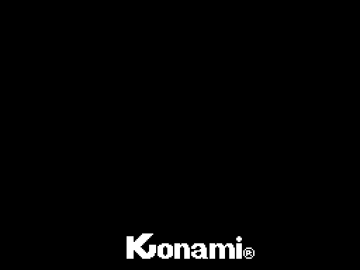
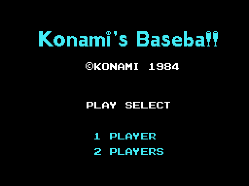
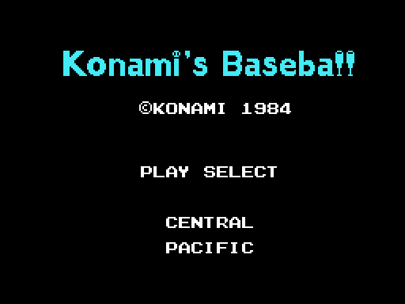
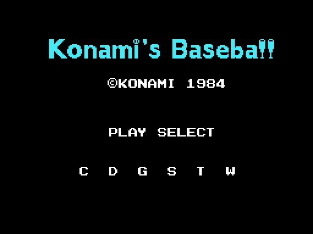
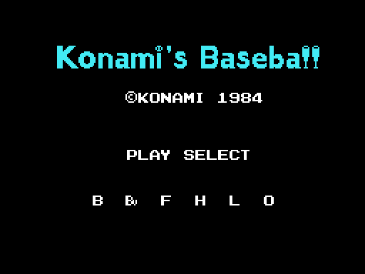
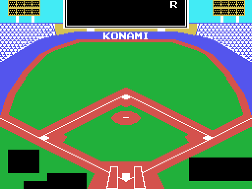
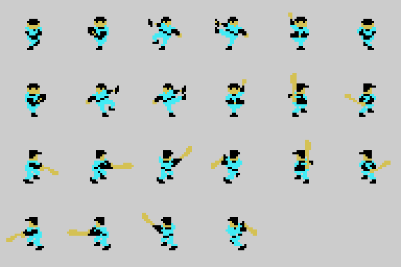
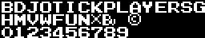

# What the cartridge draws

Under each picture is where it comes from and what is on it.

*The <b>game's title</b>, exactly as 0x44b7 paints it: not a script but <b>46 consecutive tiles</b> from 0x40 to 0x6D in two rows of 23. Since the artwork is unique, counting is enough*

*The <b>Konami logo</b> rising up the screen. The main loop writes three rows of consecutive tiles at 0x7a8b and every four frames drops the pointer by 0x20, which is one row*

*The whole <b>title screen</b>: the 0x44b7 title plus the three chained scripts at 0x46d4, which write the copyright line, PLAY SELECT and the two player lines*

*The <b>league choice</b>. 0x41a5 writes it BELOW the menu without clearing anything: the scripts at 0x470c and 0x4718 sit back to back, so asking the interpreter for two is enough*

*The <b>Central League</b> grid: C D G S T W, that is Carp, Dragons, Giants, Swallows, Tigers and Whales. The script writes the six initials over the word CENTRAL and blanks the other league's row*

*The <b>Pacific League</b> one: B Bu F H L O -Braves, Buffaloes, Fighters, Hawks, Lions and Orions-. The <b>Bu</b> is a tile made on purpose, 0xE8, so as not to repeat the B*

*The <b>stadium</b>, built the way 0x4219 builds it: clear the name table, decompress the script at 0x65ad -patterns and colours-, replicate the two missing thirds and draw the name table with the script at 0x6a1c*

*The players' <b>22 poses</b>, with their <b>three colour layers</b> placed exactly where their offsets say. The cartridge does not keep these patterns in VRAM: it uploads them from ROM every time the pose changes*

*The <b>font</b> everything is written with, tiles 0xD0 to 0xFF. It is neither ASCII nor in order: it is the 24 letters the cartridge ever writes, laid down as they were needed. Look at 0xD8..0xDE: <b>PLAYERS</b> in a row*
