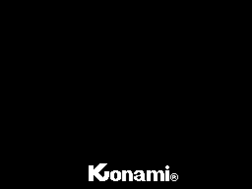
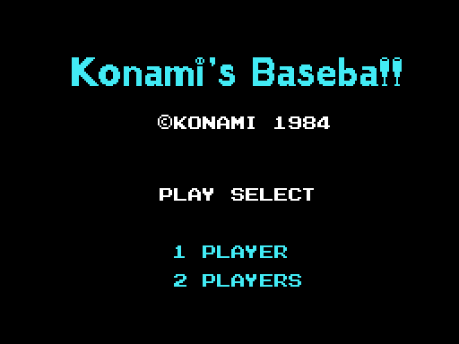
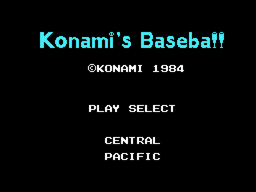
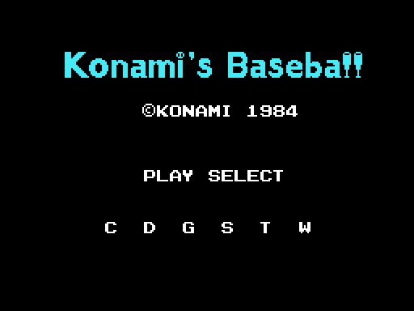
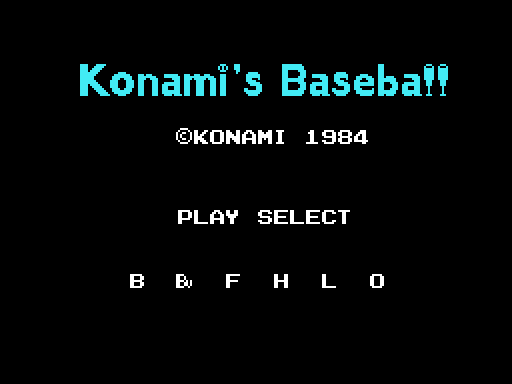
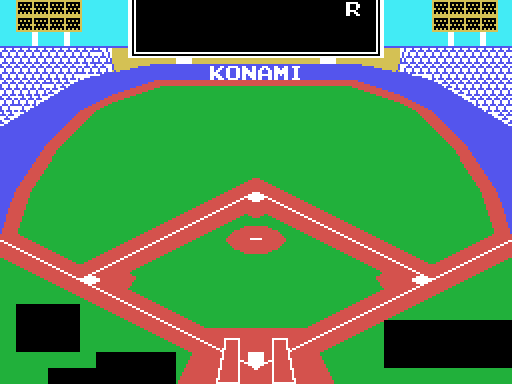
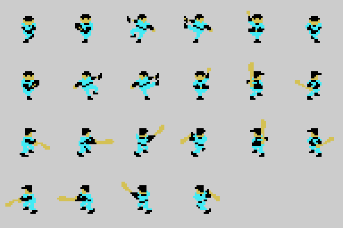
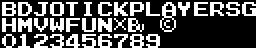

# Lo que el cartucho dibuja

Debajo de cada imagen esta de donde sale y que se esta viendo.

*El <b>rotulo del juego</b>, tal como lo pinta 0x44b7: no es un guion, son <b>46 tiles correlativos</b> del 0x40 al 0x6D en dos filas de 23. Como el dibujo es unico, basta con contar*

*El <b>logotipo de Konami</b> subiendo por la pantalla. El bucle principal escribe tres filas de tiles correlativos en 0x7a8b y cada cuatro cuadros baja el puntero 0x20, que es una fila*

*La <b>pantalla de titulo</b> entera: el rotulo de 0x44b7 mas los tres guiones encadenados de 0x46d4, que escriben el aviso de copyright, PLAY SELECT y las dos lineas de jugadores*

*La <b>eleccion de liga</b>. 0x41a5 la escribe DEBAJO del menu sin borrar nada: los guiones de 0x470c y 0x4718 van pegados uno detras del otro, asi que basta con pedirle dos al interprete*

*La parrilla de la <b>Central League</b>: C D G S T W, o sea Carp, Dragons, Giants, Swallows, Tigers y Whales. El guion escribe las seis iniciales encima de la palabra CENTRAL y borra la fila de la otra liga*

*La de la <b>Pacific League</b>: B Bu F H L O -Braves, Buffaloes, Fighters, Hawks, Lions y Orions-. La <b>Bu</b> es un tile hecho a proposito, el 0xE8, para no repetir la B*

*El <b>estadio</b>, montado como lo monta 0x4219: se borra la tabla de nombres, se descomprime el guion de 0x65ad -patrones y colores-, se replican los dos tercios que faltan y se dibuja la tabla de nombres con el guion de 0x6a1c*

*Las <b>22 posturas</b> de los jugadores, con sus <b>tres capas de color</b> puestas en el sitio exacto que dicen sus desplazamientos. El cartucho no guarda estos patrones en VRAM: los sube desde la ROM cada vez que la postura cambia*

*La <b>fuente</b> con la que se escribe todo, los tiles 0xD0 a 0xFF. No es ASCII ni va en orden: son las 24 letras que el cartucho llega a escribir, puestas segun fueron haciendo falta. Fijarse en 0xD8..0xDE: <b>PLAYERS</b> seguidos*
